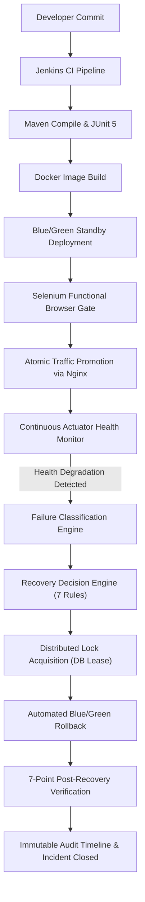

# RESILIO — Self-Healing CI/CD Platform

> **Detect. Recover. Verify.**  
> An enterprise-grade, full-stack CI/CD and automated recovery platform designed to eliminate split-brain rollbacks, blind restarts, and undetected deployment regressions.

---

## 1. Platform Overview

**RESILIO** integrates source-code management, automated builds, browser regression testing, containerized deployments, real-time telemetry monitoring, distributed recovery locks, and verified blue-green rollback into a unified engineering workflow.



---

## 2. Core Capabilities

- **CI/CD Foundation**: Java 21, Spring Boot 3.2, Apache Maven, Docker Compose, Jenkinsfile with 7 declarative stages.
- **Selenium Browser Testing**: Automated headless Chrome test suite executing functional workflow verification and regression detection.
- **Blue/Green Zero-Downtime Routing**: Nginx upstream proxy dynamically switching between `BLUE` (`:8081`) and `GREEN` (`:8082`) slots.
- **Failure Classification Engine**: Deterministic taxonomy distinguishing `BUILD_FAILURE`, `UNIT_TEST_FAILURE`, `CONTAINER_STARTUP_FAILURE`, `SELENIUM_REGRESSION_FAILURE`, and `HEALTH_CHECK_FAILURE`.
- **Decision Engine (Rules 1 – 7)**: Zero-guesswork recovery logic protecting live traffic, rejecting bad candidates, and safely rolling back post-activation incidents.
- **Distributed Recovery Locking & Leasing**: Database-backed `recovery_operations` table with lease TTLs, optimistic locking (`@Version`), atomic 409 conflict rejection, and `Idempotency-Key` duplicate suppression.
- **Startup State Reconciliation**: `RecoveryReconciliationService` verifying physical Nginx upstream disk configs on boot and aborting stale/interrupted recovery sessions to prevent split-brain states.
- **Role-Based Access Control (RBAC)**: Spring Security 6.2 with BCrypt password hashing, protecting operational mutations with `ROLE_OPERATOR` and `ROLE_ADMIN`, and providing read-only access to `ROLE_VIEWER`.
- **Observability & Request Correlation**: `CorrelationIdFilter` propagating `X-Correlation-ID` across distributed request lifecycles and SLF4J MDC, alongside regex-based `SecretMasker` credential sanitization in logs.
- **Interactive Control Center**: Single-page dashboard adhering to the Warm Ivory (`#F7F6F2`) design system with real-time health telemetry, role switcher, infrastructure health cards, and timeline audit viewer.

---

## 3. Project Structure

```text
resilio/
├── .vscode/                       # Shared VS Code configurations (launch, tasks, extensions)
├── backend/                       # Resilio Control Plane & Self-Healing Backend (Port 8090)
│   ├── src/main/java/             # Spring Boot, Security, Decision Engine, Locks, Monitors
│   ├── src/main/resources/        # application.properties, static/index.html (Dashboard)
│   └── src/test/java/             # 34 automated unit, integration, and security tests
├── demo-app/                      # Target Java Spring Boot workload (Port 8080)
│   ├── Dockerfile                 # Multi-stage production container
│   └── src/main/java/             # WebController, DataProcessingService, ChaosStateService
├── selenium-tests/                # Automated browser test suite (Selenium WebDriver)
├── deploy/                        # Deployment configurations & Nginx upstream templates
├── docs/                          # Comprehensive architectural and validation reports
│   ├── PHASE3_IMPLEMENTATION_REPORT.md  # Master Phase 3 completion report
│   ├── PHASE2_LIVE_VALIDATION_REPORT.md # Explicit validation tiers (Unit vs Live Docker)
│   ├── RECOVERY_RECONCILIATION.md       # State machine & distributed locking specification
│   ├── SECURITY_CONFIGURATION.md        # RBAC matrix, BCrypt details, and auth endpoints
│   └── WINDOWS_SETUP.md                 # Windows environment & infrastructure setup
├── scripts/                       # PowerShell testing and scenario execution scripts
├── docker-compose.yml             # Full-stack container orchestration
├── .env.example                   # Environment configuration template
└── pom.xml                        # Root parent Maven project
```

---

## 4. Default Credentials & Access Control

| Username | Role | Default Password | Permissions |
| :--- | :--- | :--- | :--- |
| `operator` | `ROLE_OPERATOR` | `Operator@Resilio2026!` | Trigger builds, candidate promotion, manual rollback |
| `admin` | `ROLE_ADMIN` | `Admin@Resilio2026!` | Full administrative capabilities & user management |
| `viewer` | `ROLE_VIEWER` | `Viewer@Resilio2026!` | Read-only telemetry access (mutations return 403) |

> Initial passwords can be overridden via `OPERATOR_INITIAL_PASSWORD`, `ADMIN_INITIAL_PASSWORD`, and `VIEWER_INITIAL_PASSWORD` environment variables.

---

## 5. Quick Start in VS Code

### Step 1: Open the Project in VS Code
In PowerShell or your terminal, navigate to the project directory:
```powershell
code .
```

### Step 2: Install Recommended Extensions
When prompted by VS Code, click **Install All** for the recommended extensions (Extension Pack for Java, Spring Boot Extension Pack, and Docker).

### Step 3: Run the Platform
You can run Resilio in two simple ways:

- **Option A (F5 / Run & Debug)**:
  1. Press `Ctrl + Shift + D` (or open the **Run and Debug** view).
  2. Select **Run RESILIO Platform (Backend)** from the dropdown.
  3. Press **`F5`** or click the green Play button.

- **Option B (VS Code Tasks)**:
  1. Press `Ctrl + Shift + P` and type `Tasks: Run Task`.
  2. Select **`1. Run Backend Server (Spring Boot)`**.

### Step 4: Open the Control Center
Navigate to **`http://localhost:8090`** in your browser.

---

## 6. Running Tests & Scenarios

- **Run all 34 backend unit, integration, and security tests**:
  ```powershell
  cd backend
  .\mvnw.cmd test
  ```
- **Run the 8 end-to-end self-healing acceptance scenarios**:
  ```powershell
  powershell -ExecutionPolicy Bypass -File scripts\test_phase2_scenarios.ps1
  ```
- **Package the deployable backend JAR**:
  ```powershell
  cd backend
  .\mvnw.cmd package -DskipTests
  ```

---

## 7. License

Licensed under the MIT License.
